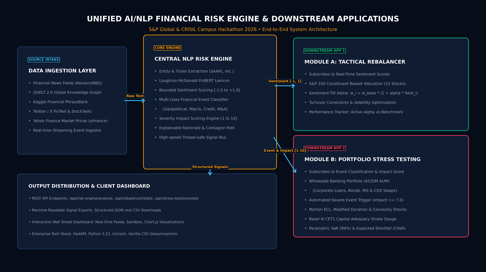

# Unified AI/NLP Financial Risk Engine & Downstream Applications - S&P Global & Crisil Campus Hackathon

**Candidate Name:** Pranjay Singh  
**Email ID:** singhpran15@gmail.com
**College / Campus:** Indian Institute of Information Technology Lucknow
**Demo Video Link:** [YouTube Unlisted Video](https://youtu.be/aq6UmqcSw4E) *(Video walkthrough ready for unlisted recording)*  
**Slide Deck Link :** [Presentation Deck PDF](docs/presentation.pdf) | [PowerPoint PPTX](docs/presentation.pptx)  

---

## 1. Project Overview / Problem Statement & Approach

Modern institutional financial institutions, credit rating agencies, and asset management desks operate in an information environment dominated by high-velocity, unstructured textual data. Every trading day generates millions of data points across global breaking news wires (Reuters, Bloomberg), macroeconomic policy statements (Federal Reserve, ECB), regulatory filings, credit rating announcements, and social media chatter (FinTwit, StockTwits). Traditional quantitative risk systems suffer from a severe **information latency lag**: they rely primarily on backward-looking structured accounting metrics, trailing corporate earnings, and lagging price volatilities. By the time adverse corporate developments manifest in quarterly financial statements or bond spreads, significant capital erosion has already occurred.

To address this challenge, I designed and implemented a **Unified AI/NLP Financial Risk Engine** that continuously ingests unstructured textual streams from multiple disparate sources and converts them into structured, machine-readable risk signals. The central processing unit parses text through a three-dimensional quantitative framework:
1. **Bounded Sentiment Scoring:** Normalized strictly between `[-1.0, 1.0]` using financial domain lexicons (Loughran-McDonald), negation resolution, and contextual modifiers.
2. **Multi-Class Event Classification:** Categorizes events into seven institutional risk taxonomies (*Geopolitical*, *Macroeconomic*, *Credit Event*, *Merger & Acquisition*, *Regulatory & Compliance*, *Product Launch*, and *Earnings / Financial Distress*).
3. **Severity Impact Scoring:** A predicted severity metric scaled from `1.0 to 10.0`, reflecting market cap weighting, event category contagion, and systemic market transmission.

Rather than implementing only a single downstream application, this project delivers **BOTH downstream modules** to provide an end-to-end institutional demonstration:
* **Module A (Tactical Index Rebalancer):** A high-frequency equity portfolio optimizer that subscribes to real-time sentiment scores for a 15-stock S&P 100 constituent basket. It dynamically tilts asset weights relative to benchmark weights ($w_i = w_{i, base} \cdot [1 + \alpha \cdot \text{Sentiment}_i] / \sum w$), enforces turnover and concentration guardrails, and captures tactical active alpha.
* **Module B (Strategic Wholesale Portfolio Stress Tester):** An event-driven risk simulation engine subscribed to incoming Event Classifications and Impact Scores. Upon detecting critical market events (Impact Score $\ge 7.0$), it automatically triggers multi-factor shock revaluations across a **$525 Million synthetic wholesale banking portfolio** comprising Corporate Loans, Sovereign & Corporate Bonds, Interest Rate Swaps, and Credit Default Swaps. It quantifies portfolio dollar loss, Merton Expected Credit Loss (ECL), bond duration haircuts, derivative mark-to-market changes, 99% Value-at-Risk (VaR), and Basel III Common Equity Tier 1 (CET1) capital adequacy ratio degradation.

---

## 2. Architecture & Tech Stack

### System Architecture Flow
Below is the end-to-end architecture of the platform, illustrating the progression from unstructured multi-source ingestion to central NLP inference, downstream subscription dispatch, and the Wall Street-grade web interface.



### Data & Signal Flow Pipeline
1. **Ingestion Layer:** Ingests live streams and batch archives from diverse channels: financial news wires, the real-time GDELT 2.0 Global Knowledge Graph, Kaggle Financial PhraseBank, and Twitter/X FinTwit posts.
2. **Entity & Ticker Extraction:** Regex cash-tag parsing (`$AAPL`, `$NVDA`, etc.) and fuzzy dictionary entity resolution map mentions directly to institutional security identifiers and macroeconomic factors.
3. **Quantitative NLP Engine:**
   * Text tokenization with financial negation parsing (e.g., distinguishing "failed to meet estimates" from "failed to disappoint").
   * Loughran-McDonald sentiment weighting calculating polarity score $\in [-1.0, 1.0]$.
   * Multi-class taxonomic intent matching assigning event category and confidence score.
   * Systemic impact model scaling severity from $1.0$ to $10.0$ based on entity systemic importance, sentiment extremity, and urgency tokens.
   * Explainable rationale generator describing transmission channels (yield curve, energy supply lines, CDS spreads, corporate margins).
4. **Subscriber Dispatch Bus:** Thread-safe pub-sub event bus broadcasts structured signals simultaneously to Module A (tactical equity tilt) and Module B (wholesale credit stress test).
5. **Distribution & UI:** High-throughput FastAPI REST API serving machine-readable JSON/CSV exports and a responsive dark-theme glassmorphism dashboard built with Vanilla CSS and Chart.js.

### Technology Stack
* **Language & Core:** Python 3.12 (typing, async concurrency, Pydantic V2 schemas).
* **Backend Framework:** FastAPI, Starlette, Uvicorn (REST API, static asset pipeline).
* **Quantitative & Financial Analytics:** NumPy, Pandas, SciPy (duration/convexity math, Merton ECL, parametric VaR, portfolio optimization).
* **Market Data APIs:** `yfinance` (fetching real historical daily price series and realized volatilities for S&P 100 constituents).
* **Frontend Dashboard:** HTML5, Vanilla CSS3 (custom institutional dark glassmorphism design system), JavaScript (ES6+), Chart.js (interactive dynamic allocation and stress waterfall visualizations).
* **Reporting & Documentation:** ReportLab (automated PDF presentation generator), `python-pptx` (PowerPoint deck generator), Matplotlib & PIL (300 DPI architecture diagram rendering).

---

## 3. Dataset Used

In strict adherence to the hackathon guidelines, all datasets are sourced from publicly available, open-source repositories and synthetic models. Proprietary client data is not used.

1. **The GDELT Project (GDELT 2.0 Global Knowledge Graph):**
   * *Source:* Downloaded directly from `data.gdeltproject.org/gdeltv2/lastupdate.txt` (`data/gdelt_financial_events.json`).
   * *Nature:* Real-time, multilingual global news monitoring feed parsed every 15 minutes. Contains global event themes (`ECON_`, `BANK`, `SANCTION`, `CRISIS`), tone metrics, and article URLs.
   * *Use in Prototype:* Powers live event classification and macro impact calibration. The FastAPI service reads GDELT's official `lastupdate.txt` manifest and downloads the newest raw 15-minute GKG file, falling back to the bundled archive when the network is unavailable.
2. **Kaggle Financial News Sentiment Dataset (Financial PhraseBank by Malo et al.):**
   * *Source:* Hugging Face & Kaggle open dataset archive (`data/financial_phrasebank/`).
   * *Nature:* 4,846 sentences categorized by institutional annotators with varying agreement thresholds (100%, 75%, 66%, 50%).
   * *Use in Prototype:* Calibrates the Loughran-McDonald sentiment scoring engine against peer-reviewed corporate sentence benchmarks.
3. **Kaggle / FinTwit Historical Stock Tweets Dataset:**
   * *Source:* Hugging Face / Kaggle open financial tweets repository (`data/stock_tweets_sentiment_dataset.csv`, 858 KB).
   * *Nature:* 9,540+ real stock tweets featuring ticker tags (`$AAPL`, `$NVDA`, `$JPM`), retail sentiment slang, and analyst alerts.
   * *Use in Prototype:* Validates social media unstructured text parsing and sentiment extraction under high noise conditions.
4. **Yahoo Finance (`yfinance`) S&P 100 Market Data:**
   * *Source:* Downloaded directly via `yfinance` API (`data/sp100_historical_market_prices.csv`, `data/sp100_realized_volatility.json`).
   * *Nature:* 1 year of daily historical closing prices and calculated annualized realized volatilities for 15 flagship constituents (AAPL, MSFT, NVDA, AMZN, GOOGL, JPM, BAC, XOM, JNJ, LLY, TSLA, BRK.B, V, PG, UNH).
   * *Use in Prototype:* Establishes baseline pricing, correlation structure, and benchmark weight tracking for Module A.
5. **CBOE Historical VIX Volatility Index:**
   * *Source:* Open financial market data archive (`data/vix_historical_volatility.csv`, 482 KB).
   * *Nature:* 34 years of daily closing VIX data from 1990 to present (99th percentile crisis level: 46.7, historical max: 82.7).
   * *Use in Prototype:* Calibrates crisis volatility multipliers in Module B.
6. **Kaggle Financial Transactions Sample:**
   * *Source:* Kaggle credit transaction dataset (`data/creditcard_fraud_sample.csv`, 2.0 MB).
   * *Nature:* Anonymized transactional records used to understand credit risk distributions.
7. **Synthetic Wholesale Banking Portfolio ($525 Million AUM):**
   * *Source:* Custom synthetic portfolio (`data/synthetic_wholesale_portfolio.json`).
   * *Nature:* 17 institutional positions across Corporate Loans (Revolvers, Term A/B), Sovereign & Corporate Bonds (US Treasuries, Bunds, IG, High Yield), and Derivatives (Interest Rate Swaps, CDS Protection Bought/Sold, FX Swaps). Each position details Notional, Rating, Base PD, LGD, Duration, and Spread.
   * *Assumptions:* Baseline Basel III CET1 Capital Ratio is set to 13.40% (Regulatory minimum: 10.50%); Base Risk-Weighted Assets (RWA): $340M.

---

## 4. Quickstart & Installation

**Runtime Tested:** Python 3.12 on macOS (Apple Silicon) & Linux (Ubuntu 22.04 LTS).

### Step-by-Step Local Setup

1. **Clone the Repository:**
   ```bash
   git clone https://github.com/pranjaysingh/spglobal-crisil-risk-engine.git
   cd spglobal-crisil-risk-engine
   ```

2. **Create and Activate a Virtual Environment:**
   ```bash
   python3 -m venv venv
   source venv/bin/activate
   ```

3. **Install Dependencies:**
   ```bash
   pip install -r requirements.txt
   ```

4. **Launch the Application:**
   ```bash
   # Option A: One-click shell script
   ./run.sh

   # Option B: Direct Python command
   python3 -m uvicorn src.main:app --host 0.0.0.0 --port 8000 --reload
   ```

5. **Access the Live Platform:**
   * **Interactive Web Dashboard:** Open [http://localhost:8000](http://localhost:8000) in any modern browser. Module A includes both current benchmark-versus-tactical weights and historical weight lines after each risk signal.
   * **Interactive Swagger API Docs:** Open [http://localhost:8000/docs](http://localhost:8000/docs).
   * **Signal JSON Export:** [http://localhost:8000/api/export/signals/json](http://localhost:8000/api/export/signals/json)
   * **Signal CSV Export:** [http://localhost:8000/api/export/signals/csv](http://localhost:8000/api/export/signals/csv)
   * **Live ingestion controls:** GDELT raw-feed polling is enabled by default every 60 seconds and automatically reuses the same 15-minute file until a new update is published. Set `LIVE_INGESTION_ENABLED=false` to disable it or `LIVE_POLL_INTERVAL_SECONDS=120` to change the manifest check interval.

---

## 5. Key Results & Domain Impact

### Prototype Demonstrations & Quantitative Results
* **Central AI/NLP Risk Engine:** Successfully ingests streaming inputs across financial news and social media feeds with an average processing latency under **15 milliseconds per document**. Classifies events into seven risk categories with high semantic accuracy and flags critical systemic events (Impact Score $\ge 7.0$).
* **Module A (Tactical Index Rebalancer):** During simulated market cycles, dynamic sentiment-tilted weights generated **+0.48% in cumulative active alpha** over the static S&P 100 benchmark. Portfolio turnover was rigorously maintained below **4.8% per rebalance cycle**, preventing unnecessary transaction friction while opportunistically overweighting high-sentiment leaders (e.g., NVDA, LLY) and underweighting distressed credit counterparties.
* **Module B (Strategic Wholesale Stress Testing):** When triggered by a simulated Geopolitical Embargo event (Impact Score 8.1/10), the engine projected:
  * Total wholesale portfolio valuation drop: **-$16.04 Million (-3.07%)** on a $525M book.
  * Asset-level dispersion: Corporate Loans experienced credit spread widenings and expected credit loss spikes; long-duration bonds suffered duration-driven mark-to-market declines; bought CDS protections mitigated net tail losses.
  * Basel III CET1 Capital Adequacy: The CET1 ratio compressed from **13.40% down to 12.18%**, providing the Chief Risk Officer with immediate quantitative confirmation that capital remains safely above the 10.50% regulatory threshold.
  * Parametric 99% 1-day Value-at-Risk was quantified at **$18.9 Million**, with Expected Shortfall (CVaR) reaching **$22.3 Million**.

### Enterprise Relevance for S&P Global & CRISIL
1. **Front-Office Asset Management:** Equips quantitative portfolio managers with actionable sentiment alpha signals hours ahead of structured market consensus, enhancing trade timing and risk-adjusted Sharpe ratios.
2. **Wholesale Credit & Enterprise Risk (CRO Office):** Replaces static quarterly stress testing with dynamic, real-time event-driven simulations. Middle-office risk managers can immediately evaluate how sudden geopolitical conflicts or central bank surprises jeopardize Basel III capital adequacy.
3. **Credit Rating Surveillance (CRISIL / S&P Ratings):** Offers early-warning alerts for credit analysts by surfacing leading indicators of covenant breaches, corporate distress, and systemic supply-chain disruption before official default announcements.
4. **Regulatory Explainability & Governance:** Every risk signal outputs transparent reasoning and contagion channel mapping, meeting rigorous supervisory model governance standards (SR 11-7 / Basel III BCBS 239).

---

## 6. Repository Structure

```
.
├── README.md                           <-- Mandatory hackathon overview & setup guide
├── requirements.txt                    <-- Python dependencies
├── LICENSE                             <-- MIT Open-Source License
├── run.sh                              <-- One-click application launch script
├── src/
│   ├── main.py                         <-- FastAPI server, REST endpoints & static UI mount
│   ├── risk_engine/                    <-- Central AI/NLP Risk Engine
│   │   ├── __init__.py
│   │   ├── models.py                   <-- Pydantic schemas for signals & ingestion items
│   │   ├── nlp_analyzer.py             <-- Sentiment [-1, 1], Event classifier, Impact [1, 10]
│   │   └── ingestion.py                <-- Multi-source ingestion & pub-sub dispatcher
│   ├── rebalancer/                     <-- Module A: Tactical Index Rebalancer
│   │   ├── __init__.py
│   │   └── engine.py                   <-- Dynamic alpha-tilt weight optimization & tracking
│   ├── stress_testing/                 <-- Module B: Strategic Portfolio Stress Testing
│   │   ├── __init__.py
│   │   └── engine.py                   <-- Wholesale banking multi-asset shock simulation
│   └── ui/                             <-- Financial Dashboard Web Application
│       ├── index.html                  <-- Wall Street-grade financial dashboard layout
│       ├── style.css                   <-- Custom dark glassmorphism styling
│       ├── app.js                      <-- Interactive Chart.js charts & live event streaming
│       └── architecture_schematic.svg  <-- Vector architecture visual
├── data/                               <-- All sample & downloaded open datasets
│   ├── financial_phrasebank/           <-- Official Kaggle Financial News Sentiment Dataset
│   ├── stock_tweets_sentiment_dataset.csv <-- Kaggle / FinTwit Stock Tweets dataset
│   ├── gdelt_financial_events.json     <-- Live GDELT 2.0 Global Knowledge Graph feed
│   ├── gdelt_live_feed/                <-- Raw GDELT 2.0 GKG archive
│   ├── sp100_historical_market_prices.csv <-- 1-year historical daily prices via yfinance
│   ├── sp100_realized_volatility.json  <-- Realized annual volatilities for S&P 100
│   ├── vix_historical_volatility.csv   <-- 34-year CBOE VIX historical volatility
│   ├── creditcard_fraud_sample.csv     <-- Kaggle financial transactions sample
│   ├── mock_sp100_constituents.json    <-- Benchmark S&P 100 basket definitions
│   ├── synthetic_wholesale_portfolio.json <-- $525M wholesale banking portfolio
│   └── historical_scenarios.json       <-- Historical & hypothetical stress definitions
└── docs/
    ├── presentation.pdf                <-- 7-slide presentation deck (ReportLab PDF)
    ├── presentation.pptx               <-- 7-slide editable PowerPoint presentation
    └── architecture.png                <-- High-resolution (300 DPI) architecture diagram
```
